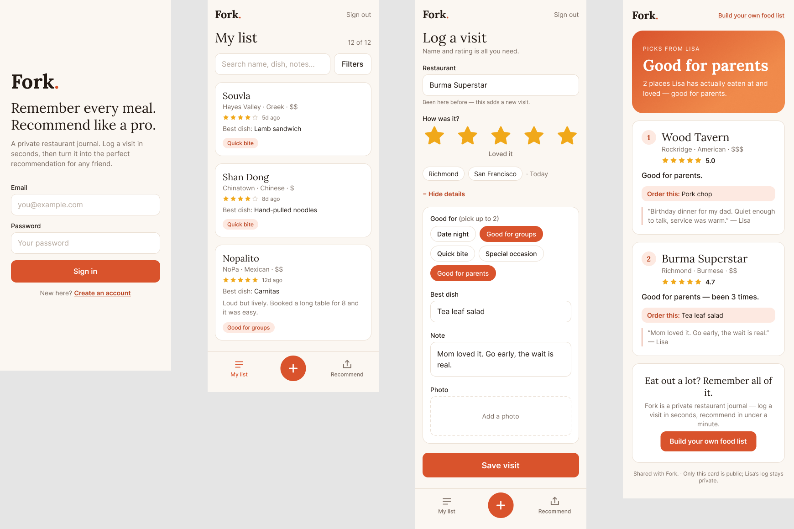
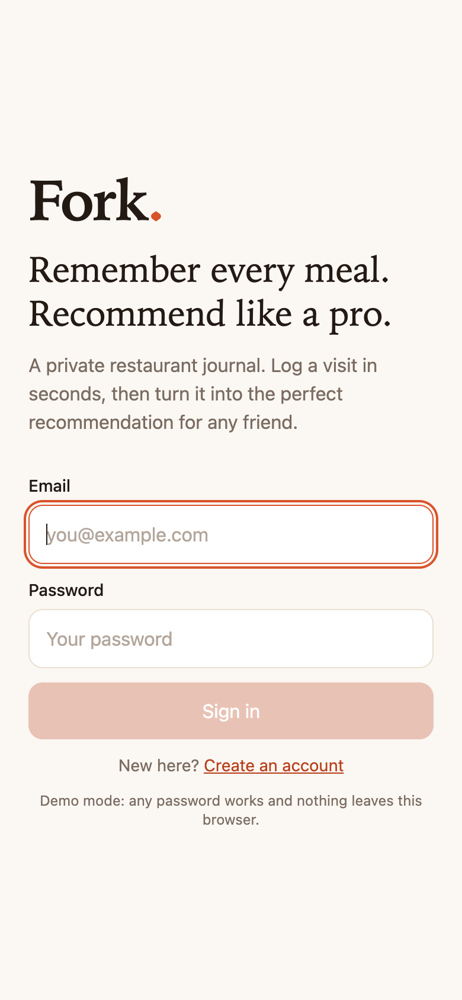
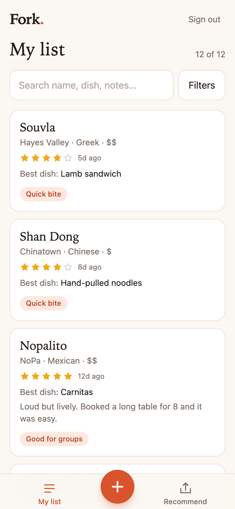
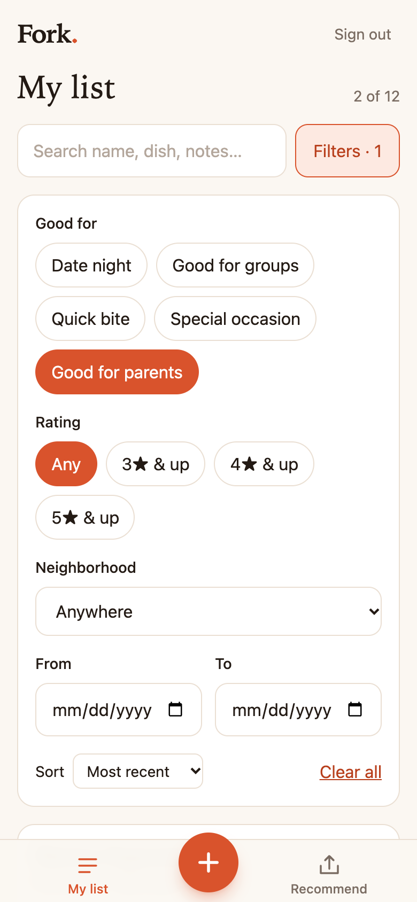
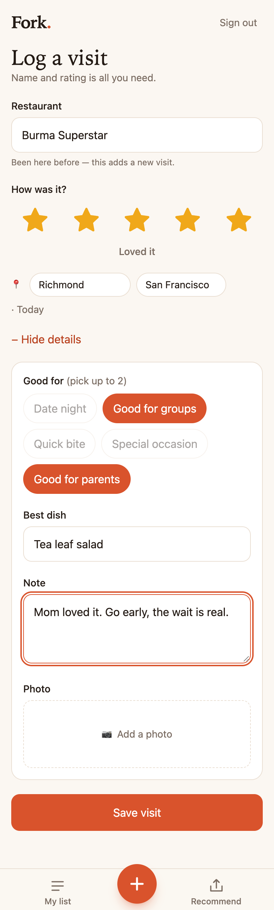
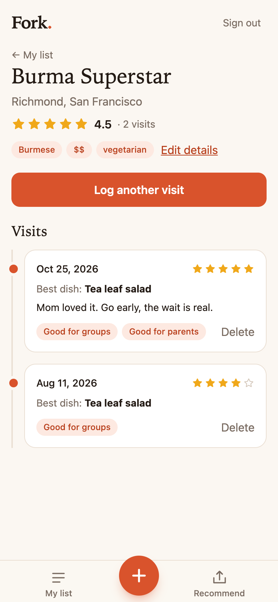
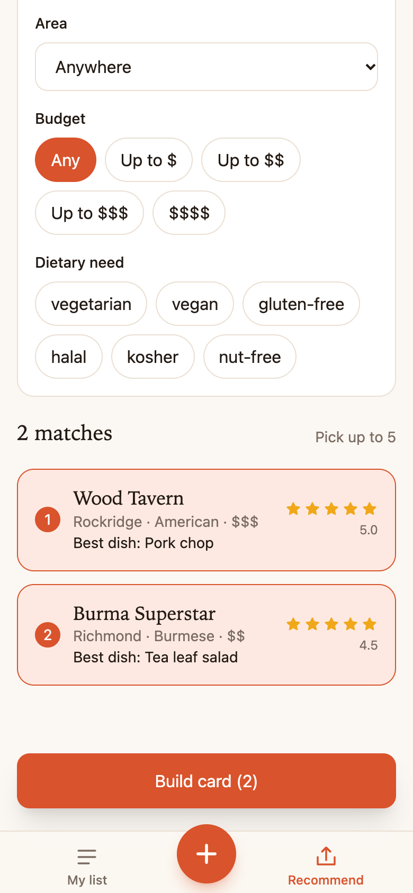
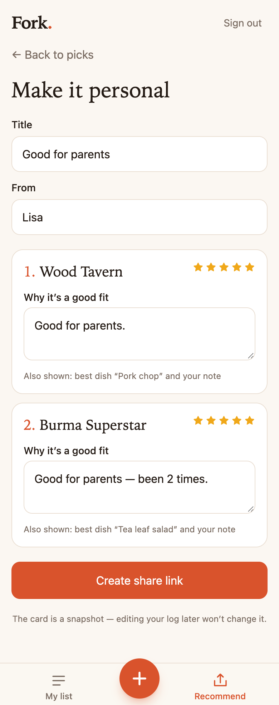
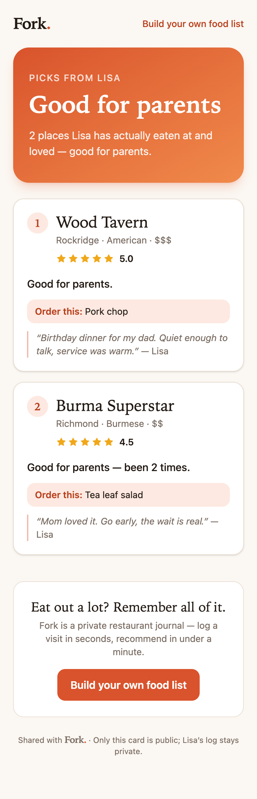

<p align="center">
  
</p>

# Fork — a private restaurant journal

Log a restaurant visit in seconds, then turn your own history into a shareable recommendation card for a friend.

- **Quick log:** name + star rating is all you need; tags, best dish, note and photo are optional.
- **My list:** search and filter by tag, rating, neighborhood and date range; per-restaurant visit history.
- **Recommend:** pick an occasion, area, budget and dietary need, choose up to 5 places from your own log, and share a public read-only link.
- **Private by default:** each user only sees their own data; only the shared card is public.

Built with React, Vite, TypeScript and Tailwind CSS. Backend: Supabase (email/password auth, Postgres with row-level security, private photo storage).

## Screenshots

<table>
  <tr>
    <td align="center"><br><sub>Sign in</sub></td>
    <td align="center"><br><sub>My list</sub></td>
    <td align="center"><br><sub>Filter by tag, rating, area, date</sub></td>
    <td align="center"><br><sub>Quick log</sub></td>
  </tr>
  <tr>
    <td align="center"><br><sub>Visit history</sub></td>
    <td align="center"><br><sub>Pick matches</sub></td>
    <td align="center"><br><sub>Make it personal</sub></td>
    <td align="center"><br><sub>Public share page</sub></td>
  </tr>
</table>

Screenshots are from the offline demo mode with sample data.

## Run it

```bash
npm install
npm run dev        # http://localhost:5173
npm run dev:lan    # also reachable from your phone on the same Wi-Fi
npm test
```

### Demo mode vs. Supabase

Without configuration the app runs in **offline demo mode**: data lives in `localStorage` and any password signs you in.

To use Supabase, copy `.env.example` to `.env.local` and fill in your project's URL and publishable key:

```
VITE_SUPABASE_URL=https://<your-project>.supabase.co
VITE_SUPABASE_PUBLISHABLE_KEY=<your publishable key>
```

The app expects these tables: `tags`, `restaurants`, `visits`, `visit_tags`, `recommendation_lists`, `recommendation_items`, the RPC functions `log_visit`, `create_recommendation` and `get_public_recommendation`, and a private `visit-photos` storage bucket, all protected by row-level security. The schema is not yet checked into this repo.

## Structure

- `src/data/repository.ts`, `auth.ts`: the interfaces the UI talks to.
- `src/data/localRepository.ts`, `supabaseRepository.ts`: the two implementations.
- `src/pages/`: Login, List, Log, Detail, Recommend, Share.
- `src/lib/`: filtering, validation and recommendation logic (unit tested).
